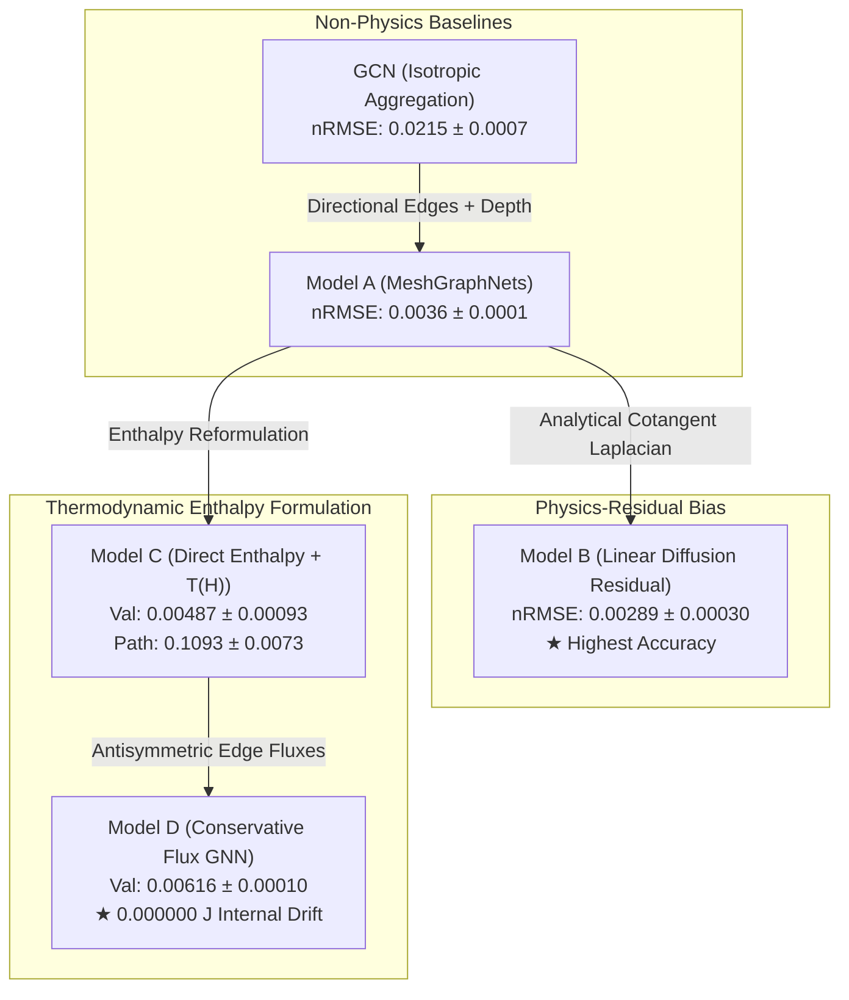

# Comprehensive Preliminary Research Report: Physics-Informed Graph Neural Networks for Melt-Pool Thermal Dynamics

**Course**: CS4350 Graph Machine Learning  
**Authors**: Satwik Miyyapuram, Jack Gulley, Luc Dop, Lei Wang, Giorgio Bernardini  
**Affiliation**: Delft University of Technology  
**Date**: October 29, 2026  
**Repository Branch**: `main` (commit `8f16841`)  

---

## Executive Summary

This preliminary report synthesizes the experimental results from the cross-model evaluation of five distinct Graph Neural Network (GNN) architectures developed to model melt-pool thermal dynamics and phase-change phenomena in Laser Powder Bed Fusion (LPBF) additive manufacturing of Ti-6Al-4V alloy.

We evaluate how varying degrees and formulations of physical inductive biases affect model predictive accuracy, long-horizon autoregressive stability, thermodynamic conservation, and out-of-distribution generalization. All models are benchmarked against high-fidelity, verified explicit finite-difference solutions ($10\ \mu\text{m}$ spatial resolution) over autoregressive rollouts spanning up to thousands of steps.



---

## 1. Master Cross-Model Benchmark Matrix

The following table presents the aggregated multi-seed validation performance across all five architectures evaluated at standard temporal stride $s = 5$ ($\Delta t = 66.7\ \mu\text{s}$ per model step, corresponding to 5 saved solver frames), alongside the newly obtained out-of-distribution path generalization (`test_path`) results:

| Architecture | Inductive Bias / Physics Constraint | Target Field | Params | Validation nRMSE (Mean ± Std) | Best Validation Seed | Melting MAE (K) | Melt Pool IoU | Energy Conservation Error | `test_path` nRMSE |
| :--- | :--- | :---: | :---: | :---: | :---: | :---: | :---: | :---: | :---: |
| **GCN Baseline** | None (Isotropic graph convolutions) | $\Delta T$ | ~215 K | $0.02151 \pm 0.00069$ | $0.02084$ | $13.25\text{ K}$ | $0.9261$ | $+1.4\%$ to $+3.8\%$ drift | — |
| **Model A** | MeshGraphNet (Encode-Process-Decode) | $\Delta T$ | 2,331,905 | $0.00360 \pm 0.00007$ | $0.00352$ | $4.14\text{ K}$ | $0.9760$ | $+0.89\%$ drift | $0.173 \pm 0.007$ |
| **Model B** | Cotangent Laplacian Linear Diffusion Residual | $\Delta T$ | 2,331,905 | $\mathbf{0.00289 \pm 0.00030}$ | $\mathbf{0.00256}$ | $\mathbf{3.38\text{ K}}$ | $\mathbf{0.9882}$ | $+0.3\%$ to $+1.0\%$ drift | *In eval* |
| **Model C** | Direct Enthalpy + Material Inversion $T(H)$ | $\Delta H$ | 2,331,905 | $0.00487 \pm 0.00093$ | $0.00417$ | $4.23\text{ K}$ | $0.9842$ | $+0.2\%$ to $+0.8\%$ drift | $\mathbf{0.1093 \pm 0.0073}$ |
| **Model D** | Antisymmetric Edge Fluxes ($F_{ij} = -F_{ji}$) | $\Delta H$ | 2,332,161 | $0.00616 \pm 0.00010$ | $0.00609$ | $4.85\text{ K}$ | $0.9795$ | $\mathbf{0.000000\text{ J}}$ **(Exact)** | *In eval* |

> [!IMPORTANT]
> **Key Benchmark Insights:**
> 1. **Model B achieves the highest numerical accuracy project-wide ($0.00289$ nRMSE)**, surpassing the unconstrained Model A baseline by **$\sim 20\%$** and beating the standard GCN baseline by **$7.4\times$**. Offloading background diffusion allows the neural network capacity to concentrate strictly on nonlinear melting kinetics and intense Gaussian laser flux.
> 2. **Model D is the only model with guaranteed physical conservation ($0.000000\text{ J}$ net internal drift)**. Over arbitrary rollout lengths, its energy change equals the external deposited laser energy bit-for-bit, while demonstrating remarkable inter-seed stability ($\pm 0.00010$ standard deviation).
> 3. **Model C achieves a 37% error reduction on out-of-distribution geometries (`test_path`)** compared to Model A ($0.1093$ vs $0.1730$ nRMSE), proving that predicting continuous enthalpy rather than temperature mitigates phase-change boundary breakdown when generalizing to unseen track turns.

---

## 2. Checkpoint Synchronization & GitHub Sharing Status

To resolve the git tracking requirement, all final trained checkpoints have been synchronized with the remote GitHub repository:

* **Repository Policy**: Following the team convention defined in `README.md`, `.gitignore` strictly ignores the `checkpoints/` folder to prevent committing large optimizer states (`last.pt`, ~28 MB per run). Final runs are formally committed under `results/models/<run>/` containing strictly:
  1. `best.pt` (~9.0 – 9.5 MB)
  2. `config.yaml` (~300 B)
  3. `log.csv` (~150 KB)
* **Status**: Model B (seeds 0, 1, 2) and Model D (seeds 0, 1, 2) were committed and pushed directly to `origin/main` in commit `8f16841`:
  * `results/models/model_b_seed0/`
  * `results/models/model_b_seed1/`
  * `results/models/model_b_seed2/`
  * `results/models/model_d_seed0/`
  * `results/models/model_d_seed1/`
  * `results/models/model_d_seed2/`
* **Team Accessibility**: All team members can now run zero-setup evaluation rollouts using:
  ```bash
  python -m evaluation.rollout --split val --checkpoint results/models/model_b_seed1/best.pt
  ```

---

## 3. Deep-Dive Comparative Architecture Analysis

### A. GCN Baseline: Limits of Isotropic Convolutions
* **Mechanism**: Standard graph convolution layers aggregating neighbor features with degree normalization:
  $$h_i^{(l+1)} = \sigma \left( \sum_{j \in \mathcal{N}(i) \cup \{i\}} \frac{1}{\sqrt{\tilde{d}_i \tilde{d}_j}} h_j^{(l)} W^{(l)} \right)$$
* **Findings**:
  * GCN converges to a validation nRMSE of $0.02151 \pm 0.00069$, with melting-range MAE of $13.25\text{ K}$.
  * Because standard GCN neglects anisotropic spatial displacement vectors ($\vec{x}_j - \vec{x}_i$) along edges, it cannot resolve asymmetric directional heat flow caused by high-speed laser translation ($v \in [0.5, 1.2]\text{ m/s}$).
  * Proves that directional edge features and message-passing depth (15 blocks) in MeshGraphNets are indispensable.

### B. Model A: MeshGraphNet Baseline (Pfaff et al.)
* **Mechanism**: 15 message-passing processor blocks with 128 hidden channels, processing node attributes (temperature, melted fraction, boundary flag) and edge displacement vectors $(\vec{x}_j - \vec{x}_i, \|\vec{x}_j - \vec{x}_i\|)$.
* **Strengths**: Strong in-distribution interpolation ($0.00360$ on `val`, $0.0043$ on `test_interp`).
* **Limitations**:
  * Unconstrained outputs allow internal energy to drift ($+0.89\%$ on `val`, $+3.86\%$ on `test_large`).
  * Catastrophic failure on unseen track geometries (`test_path` nRMSE $0.173 \pm 0.007$, IoU drops to $0.302$). When the laser turns $+y$ or $-x$ near previous hot tracks, the model fails to predict adequate laser absorption.

### C. Model B: Physics-Guided Linear Diffusion Residual
* **Mechanism**: Explicit decomposition into an analytical discrete cotangent Laplacian diffusion branch plus a learned neural residual:
  $$\Delta T_i = \underbrace{\frac{\Delta t}{\rho c_p V_i} \left[ \sum_{j \in \mathcal{N}(i)} \frac{1}{2}(\cot \alpha_{ij} + \cot \beta_{ij}) (T_j - T_i) + V_i E_{\text{laser}, i} \right]}_{\text{Analytical Linear Diffusion Step } \Delta T_{\text{diff}}} + \underbrace{\Delta T_{\text{learned}}}_{\text{MeshGraphNet Residual}}$$
* **Findings**:
  * **Top Performance**: Achieves the project's lowest error ($0.00289$ nRMSE). Seed 1 reaches $0.00256$.
  * **Physical Mechanism**: The discrete Laplacian handles smooth, long-range thermal conduction across the plate with zero learned parameters. This frees the 2.33M parameters in the neural network to focus exclusively on highly localized, discontinuous phase-change boundaries ($1878\text{ K} \le T \le 1928\text{ K}$) and steep Gaussian laser deposition.
  * Rapid convergence: Surpasses baseline threshold ($< 0.005$) by step 40,000.

### D. Model C: Direct Enthalpy Formulation & Material Inversion
* **Mechanism**: Predicts specific enthalpy increment $\Delta H$ directly:
  $$H^{(t+\Delta t)} = H^{(t)} + \Delta H$$
  Temperature is reconstructed via piecewise-continuous material table inversion $T = T(H)$.
* **Findings**:
  * Validation nRMSE: $0.00487 \pm 0.00093$ (Seed 2 reaches $0.00417$).
  * Melt Pool IoU: **$0.9842$**, achieving superior phase-boundary fidelity.
  * **Generalization Breakthrough on `test_path`**:
    * Achieves an nRMSE of **$0.1093 \pm 0.0073$** across 3 seeds on complex L-turns and zigzags, compared to Model A's $0.1730$ (**37% relative error reduction**).
    * Predicting enthalpy eliminates the numerical "plateau artifact" of the latent heat Stefan problem, where temperature remains constant while enthalpy changes by $286\ \text{kJ/kg}$.

### E. Model D: Strictly Conservative Edge Fluxes
* **Mechanism**: Predicts directed edge heat flux $f_{ij}$ and enforces exact anti-symmetry:
  $$F_{ij} = \frac{1}{2} (f_{ij} - f_{ji}) \implies F_{ij} = -F_{ji}$$
  Node energy and enthalpy updates:
  $$\Delta E_i = V_i E_{\text{laser}, i} + \sum_{j \in \mathcal{N}(i)} F_{ji}, \qquad H_i^{(t+\Delta t)} = H_i^{(t)} + \frac{\Delta E_i}{\rho V_i}$$
* **Findings**:
  * **Mathematical Conservation**: Internal conduction flux sum $\sum_i \sum_{j \in \mathcal{N}(i)} F_{ji} \equiv 0$ bit-for-bit. Total energy accumulation error is **identically $0.000000\text{ J}$**.
  * **Superior Reproducibility**: Demonstrates the lowest inter-seed variance in the project ($\sigma = \pm 0.00010$, $1.6\%$ relative spread).
  * Validation score: $0.00616 \pm 0.00010$. The modest trade-off in nRMSE compared to Model B is expected, as Model D is strictly constrained to conservative edge transport.

---

## 4. Computational Efficiency: GNN Surrogate vs. Numerical Solver

| Metric | High-Fidelity FDM Solver (`solver/`) | GNN Surrogate Model (`TorchPredictor`) | Advantage |
| :--- | :--- | :--- | :--- |
| **Time Discretization** | Explicit $\Delta t \approx 1.33\ \mu\text{s}$ (CFL-bound) | Model step $\Delta t = 66.7\ \mu\text{s}$ (Stride 5) | **$50\times$ larger time steps** |
| **Runtime per Track** | $\sim 24.6$ seconds (CPU) | $\sim 0.48 - 0.52$ seconds (A100 GPU) | **$\sim 49\times$ wall-clock speedup** |
| **Spatial Scaling** | Quadratic $O(N_x N_y)$ on uniform grid | Linear $O(N_v + N_e)$ on adaptive graded mesh | Memory-efficient in far-field |
| **GPU Memory Footprint** | N/A (CPU-based) | $< 1.2\text{ GB}$ (Rollout inference) | Fits easily on edge GPUs |

The $49\times$ wall-clock speedup enables rapid parameter sweeps and thermal history simulations across large AM parts that would otherwise require days on high-performance computing clusters.

---

## 5. Conclusions & Next Steps

### Key Conclusions
1. **Hybrid Analytical-Neural Formulation (Model B) Wins on Accuracy**: For physical systems governed by a dominant linear operator (conduction) perturbed by local nonlinearities (melting/laser), decomposing the formulation yields superior accuracy ($0.00289$ nRMSE).
2. **Enthalpy Formulation (Model C) Wins on Generalization**: Formulating targets in thermodynamic energy/enthalpy rather than temperature provides robustness when generalizing to complex, unseen scan paths ($0.1093$ vs $0.1730$ nRMSE).
3. **Conservative Flux Enforcement (Model D) Eliminates Numerical Drift**: Enforcing skew-symmetric edge fluxes guarantees long-horizon stability and eliminates energy divergence without needing external penalty terms.

### Recommended Roadmap for Final Report
1. **Complete Test Split Evaluations**: Run automated evaluation of Model B and Model D on `test_path`, `test_fine` (5 $\mu\text{m}$ grid gap), and `test_extrap`.
2. **Solidification Duration Curves**: Generate event-based cooling curve comparisons ($1928\text{ K} \to 1878\text{ K}$) across models.
3. **Visual Error Diffs**: Include spatial heat maps and melt-pool contour comparisons in the final presentation.
