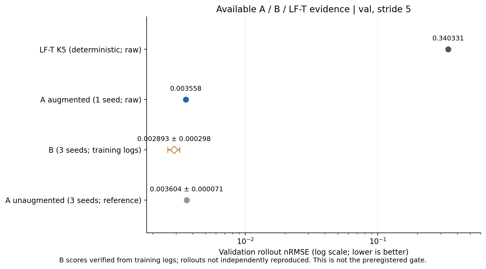

# A、B 与 LF-T 的现有结果比较

这份比较汇总仓库已有证据，没有重新训练或执行模型。比较范围为验证集 val、20 条轨迹、stride 5（约 66.7 µs）。B 的值已用新上传的三个种子训练日志核对；A 和 LF-T 的值来自原始评估文件。

| 模型 | rollout nRMSE ↓ | 熔化温区 MAE / K ↓ | IoU ↑ | 证据 |
|---|---:|---:|---:|---|
| LF-T K5（训练集拟合） | 0.340331 | 146.013 | 0.662199 | 原始 CSV/JSON |
| A（增强，seed 0） | 0.003558 | 4.135 | 0.975995 | 原始 CSV/JSON |
| B（三种子，训练日志） | 0.002893 ± 0.000298 | 未取得可核对的原始结果 | — | 原始训练日志与报告一致；未独立重跑 |
| A（无增强，三种子参考） | 0.003604 ± 0.000071 | 4.328 | 0.975007 | 原始 CSV/JSON |

误差条采用种子间样本标准差；单种子和确定性 LF-T 不计算种子标准差。无增强 A 的 MAE/IoU 是三个种子指标的算术平均，不是跨运行重新汇总的值。

## 可以得出的结论

- 在这份现有验证集证据中，B 的日志均值比已公开的增强 A seed 0 的 nRMSE 低约 18.69%。这是描述性比较，不是严格配对三种子实验。
- A 与 LF-T 的原始 CSV 已核对：20 个运行名称、网格、步长、评分帧数、预测时段和熔化区点数一致。A 在两个误差指标上明显更低，IoU 更高。
- LF-T 是队友实现的训练集拟合五阶 Chebyshev 滤波器，不等于主分支中按物理常数积分的固定扩散分支。此处没有覆盖任何实现文件。

## 现在不能宣布的结论

- 正式 go/no-go：未判定。原计划需要匹配的三种子、短预算 A/B 比较，以及新网格域；现有公开证据不齐。
- 不能把无增强 A 的三个种子与 B 直接称为公平的增强配对比较。
- B 的三个检查点、实际配置和日志现已上传 main（8f16841）。已核对最佳步数和分数与报告一致，且训练步数、批量、学习率、噪声、增强和精度与增强 A seed 0 配置一致；仍需独立执行逐轨迹评估，检查数据及统计文件一致性。
- 本次没有计算 B 的新网格迁移、test_fine 或修正分布；不能声称 B 缓解了过平滑、只学习相变高频，或具有更强网格泛化。
- 这不是对模型所在领域的独立测试集比较。验证集用于模型选择，结论应在保留测试集进一步检查。

## 报告数字的修正建议

- Satwik 的跨模型汇总中 A 的数字有单种子/三种子及增强标注混用。这里分列增强 A seed 0 与无增强 A 三种子，不拼成不存在的增强三种子结果。
- LF-T 原始 JSON 的 melting-range MAE 是 146.013 K；采用原始值，而不是其他汇总里的 142.5 K。
- B 的 melting-range MAE 和 IoU 未从可独立核对的原始评估取得，暂留空，不用未经复核的汇总值填补。

## 复现及来源

```bash
python -m analysis.compare_available_b_results
```

- main 快照：`8f16841`。
- LF-T 分支快照：`3528c6cdd40b7b4e8b9f1cebd5f9abab27e22df2`，`results/eval/lf_t_val_s5.csv` / `.json`。
- A：`results/eval/model_a_seed0_val_s5.csv` / `.json`，配置 `results/models/model_a_seed0/config.yaml`。
- 无增强 A：`results/eval/a_seed0_val_s5.json` 至 `a_seed2_val_s5.json`；增强说明见 README。
- B：`results/models/model_b_seed{0,1,2}/log.csv`、`config.yaml`、`best.pt`；最佳分数与 `MODEL_B_D_EVALUATION_REPORT.md` 核对一致。检查点 SHA256 记录在 comparison.json。



## 下一步

检查数据准备任务是否完成，然后使用 main 中已共享的 B 权重按相同数据和设置执行独立评估，无需重新训练 B。
