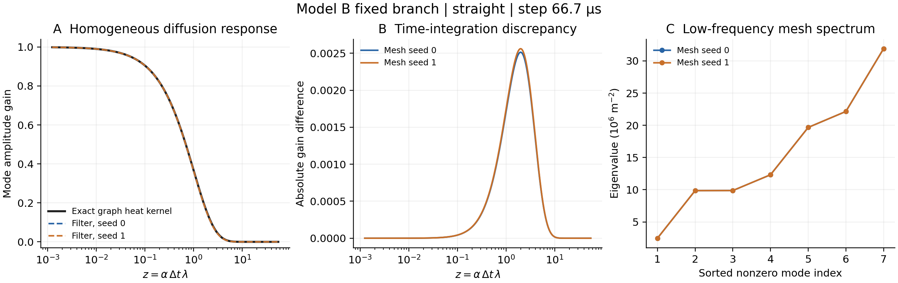

# Model B methods and preliminary spectral analysis

This draft describes the implemented method and completed, checkpoint-free
spectral calculations. It contains no trained Model B performance claims.
Formal gate, correction-map and transfer results remain pending GPU access.

## Model B method

We augment the shared MeshGraphNet backbone with a fixed linear diffusion
prediction on the triangular learning mesh. Let M be the diagonal matrix of
lumped node areas and K the symmetric cotangent stiffness matrix, with
K_ii = sum_j w_ij and K_ij = -w_ij. The source-free temperature dynamics are

    dT/dt = -alpha M^-1 K T,     alpha = k/(rho cp).

We fix k = 20 W/(m K), cp = 600 J/(kg K), and rho = 4420 kg/m³, giving
alpha = 7.54148e-6 m²/s. Boundary conditions are insulated. Signed cotangents
are retained, preserving the finite-element stiffness operator. This branch
uses constant properties and does not represent latent heat or variable
conductivity; the learned correction must account for these effects and
discretisation differences.

For a model step Delta t, the fixed branch uses n stable explicit substeps:

    T^(l+1) = T^l - (alpha Delta t/n) M^-1 K T^l + E/(rho cp n),
    D(T,E) = T^n - T.

E is the laser energy per volume integrated over the full model step, using
the shared solver-consistent source schedule. It is distributed equally over
the substeps. The substep count satisfies

    n >= (2 alpha Delta t / 0.9) max_i [sum_j |w_ij| / M_ii].

This bound controls the largest eigenvalue even when individual cotangents
are negative. It is a sufficient stability bound, not a positivity guarantee
on arbitrary meshes. The weighted sum of the fixed conduction increment is
zero, but the entire model does not guarantee enthalpy conservation.

The shared Model A architecture supplies a learned correction f_theta(g).
With the train-only dT target mean mu and standard deviation sigma, B returns

    z_hat = [D(T,E) - mu]/sigma + f_theta(g),
    T_next = T + D(T,E) + sigma f_theta(g).

Thus zero network output means zero learned physical correction. We train on
the same normalised total dT target as A, using the shared training loop. The
backbone, node/edge features, parameter count, optimiser, noise, augmentation,
training budget and checkpoint selection criterion are matched to A. Both
models start from paired random initialisations; B does not start from a
pretrained A checkpoint. Rotations/reflections change positions and edge
vectors while leaving scalar cotangent weights and node areas invariant.

## Preregistered gate procedure

The default short comparison comprises A and B at 20,000 steps, three seeds
(0, 1, 2), stride 5, with the same training and augmentation settings. The
fixed filter is B's physical branch alone, with no fitted parameters. Select
checkpoints only by mean validation rollout nRMSE. Evaluate all models on
the full val split and test_interp on graph seed 1; report melting-range MAE
(1,800–2,000 K) alongside nRMSE.

For each domain, define improvement = mean(nRMSE_A) - mean(nRMSE_B) and
margin = max(sample_std_A, sample_std_B). The preregistered primary criterion
requires improvement > margin in both domains. Otherwise choose No-go.
This operational rule is not a statistical significance test. The fixed
baseline is deterministic; duplicating its score under the three paired seed
labels does not create independent trials. Do not change the rule after
seeing the results.

## Completed spectral calculation

We analyse the symmetric mass-normalised operator S = M^-1/2 K M^-1/2.
For a mode with eigenvalue lambda, the exact source-free evolution of this
same graph operator has gain exp(-alpha Delta t lambda). The implemented
substepped filter has gain (1 - alpha Delta t lambda/n)^n. This comparison
isolates time integration of linear diffusion. It does not compare with the
nonlinear phase-changing solver or a fitted LF-T/LF-H polynomial filter.

Two independently jittered straight-track meshes were analysed at 66.7 µs.
The plotted curve samples 256 positive frequencies plus zero; the sampled
frequencies are a continuous response grid, not 256 computed mesh eigenvalues.
Eight low eigenvalues and the largest eigenvalue are computed separately.

| Graph seed | Nodes | Explicit substeps | Largest eigenvalue (m^-2) | Max sampled absolute gain difference |
|---|---:|---:|---:|---:|
| 0 | 5,172 | 108 | 1.09818e11 | 0.002514 |
| 1 | 5,174 | 106 | 1.10140e11 | 0.002561 |

The constant mode has approximately zero eigenvalue on both meshes and gain
one. Higher-frequency modes are damped more strongly. The explicit filter
is slightly more dissipative than the exact graph heat kernel, with a maximum
sampled amplitude-gain discrepancy of about 0.0026. This number is not a
temperature error, a rollout nRMSE, or a percentage improvement of Model B.

The seven sorted nonzero low eigenvalues differ by at most approximately
0.0089% between graph seeds. This describes stability of this small part of
the spectrum; it does not establish eigenvector alignment or trained-model
mesh transfer. Near-degenerate modes should be interpreted as a subspace.



Figure caption: Source-free constant-property diffusion on two straight-track
learning meshes at 66.7 µs. (A) Fixed-filter gain versus the exact semidiscrete
graph heat kernel. (B) Absolute gain discrepancy on the sampled frequency
grid. (C) Seven sorted nonzero low-frequency eigenvalues. The zero mode is
omitted from logarithmic frequency axes. The figure requires no trained
checkpoint and does not establish a Go/No-go result.

## Results still required

- Gate table: A/B/fixed-filter means and sample standard deviations on val
  and graph-seed-1 test_interp; per-domain improvements and margins; verdict.
- If Go: equal-budget tuning and three final seeds using the best validation
  configuration. If No-go: retain the filter and expand spectral interpretation.
- Correction maps: area-weighted absolute learned correction share inside
  1,800–2,000 K versus that band's area share, using real B checkpoints.
- Transfer: test_interp graph seeds 0 and 1, plus test_fine beside the paired
  solver-to-solver gap. test_fine changes only the solver truth and the gap
  is not a model error floor; solidification there is diagnostic only.

## Reproduction

Run from the repo root in the project environment:

```bash
python -m analysis.spectra --mesh straight --seeds 0 1 --modes 8 --step-us 66.7 --out results/lei/spectral_response.json
python -m analysis.plot_model_b_spectra
```

Numerical source: results/lei/spectral_response.json. Figure and numerical
summary: results/lei/spectral_report/. Training commands and dependencies are
listed in docs/lei_model_b.md. The separate checklist docs/lei_team_alignment.md
records the decisions to confirm before formal training.
