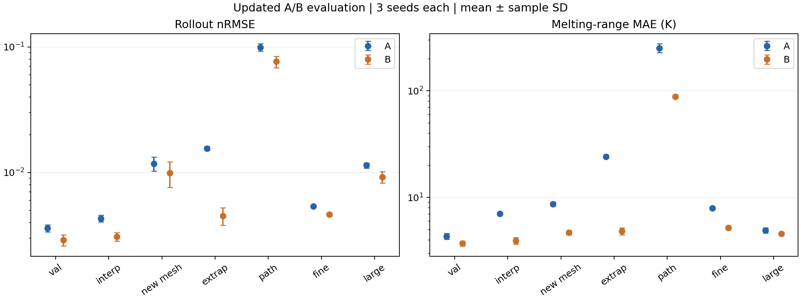
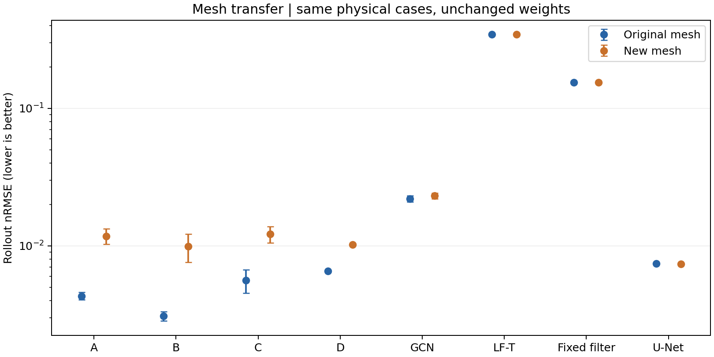

# Model B comparison and mesh transfer

Updated 6 November 2026.

This analysis replaces the old A-seed-0 comparison. It uses the three current augmented A checkpoints, B seeds 0–2, and Luc's committed per-run evaluation files. No new training or rollout is claimed. Combined evaluation snapshot is in the pending luc/main-results-table branch (which includes luc/evaluate-all-models); B test files are not yet main at this snapshot.

## Protocol and audit

A and B have the same 100,000-step budget, batch size, learning-rate schedule, noise, augmentation, precision, stride 5 and backbone settings. Best validation checkpoints may occur at different steps. Checkpoint fingerprints match, and each evaluated checkpoint blob matches the current shared weights. We recomputed per-run nRMSE means and pooled melting MAE, and checked identical run sets, scoring frames, mesh labels, size bins and true melting-region point counts across models. Melting-range MAE uses true temperatures 1800–2000 K. Values are per-seed split metrics, then seed mean ± sample SD; this is not a confidence interval. Filter results are deterministic; U-Net has one seed. Training normalization agrees within floating-point roundoff. Training runtimes differ: A checkpoints record PyTorch 2.9.1+rocm7.2.1, B records 2.5.1. Thus this is a matched-hyperparameter comparison of available team runs, not an identical-backend controlled retraining experiment.

## Updated A/B comparison

| Domain | A nRMSE | B nRMSE | B reduction | A melting MAE / K | B melting MAE / K |
|---|---:|---:|---:|---:|---:|
| val | 0.003608 ± 0.000233 | 0.002893 ± 0.000298 | 19.8% | 4.343 ± 0.289 | 3.707 ± 0.199 |
| test_interp | 0.004312 ± 0.000267 | 0.003077 ± 0.000244 | 28.6% | 7.060 ± 0.184 | 3.941 ± 0.288 |
| test_interp_seed1 | 0.011776 ± 0.001489 | 0.009905 ± 0.002296 | 15.9% | 8.689 ± 0.365 | 4.697 ± 0.220 |
| test_extrap | 0.015577 ± 0.000586 | 0.004522 ± 0.000720 | 71.0% | 24.095 ± 0.686 | 4.829 ± 0.356 |
| test_path | 0.099304 ± 0.006750 | 0.076476 ± 0.008090 | 23.0% | 252.182 ± 24.009 | 88.472 ± 3.177 |
| test_fine | 0.005394 ± 0.000089 | 0.004632 ± 0.000124 | 14.1% | 7.944 ± 0.175 | 5.210 ± 0.201 |
| test_large | 0.011406 ± 0.000538 | 0.009218 ± 0.000967 | 19.2% | 4.938 ± 0.285 | 4.591 ± 0.121 |

The earlier 18.69% reduction used B's three-seed mean against an obsolete A seed 0. It is superseded by the matched three-seed comparison above.

## Filter reference

| Model | Validation nRMSE | Melting MAE / K | IoU |
|---|---:|---:|---:|
| A | 0.003608 ± 0.000233 | 4.343 ± 0.289 | 0.974881 ± 0.001991 |
| B | 0.002893 ± 0.000298 | 3.707 ± 0.199 | 0.977375 ± 0.001234 |
| LF-T | 0.340331 | 146.013 | 0.662199 |
| Fixed filter | 0.150486 | 311.306 | 0.484862 |

LF-T has five polynomial coefficients plus one source coefficient (six fitted values). The fixed physical filter has zero fitted parameters; the two baselines must remain distinct.

## Mesh transfer

| Model | Original mesh nRMSE | New mesh nRMSE | New/original |
|---|---:|---:|---:|
| A | 0.004312 ± 0.000267 | 0.011776 ± 0.001489 | 2.73× |
| B | 0.003077 ± 0.000244 | 0.009905 ± 0.002296 | 3.22× |
| C | 0.005609 ± 0.001083 | 0.012187 ± 0.001647 | 2.17× |
| D | 0.006545 ± 0.000089 | 0.010227 ± 0.000114 | 1.56× |
| GCN | 0.022037 ± 0.001184 | 0.023070 ± 0.001129 | 1.05× |
| LF-T | 0.343973 | 0.344917 | 1.00× |
| Fixed filter | 0.154698 | 0.154712 | 1.00× |
| U-Net | 0.007399 | 0.007383 | 1.00× |

The new mesh keeps the test_interp physical cases fixed and changes mesh seed 0 to 1 without retraining. A lower new-mesh error and a smaller degradation ratio are different claims; both are reported. This tests one prescribed mesh perturbation, not arbitrary remeshing or node-density changes. U-Net uses a fixed regular grid with outputs sampled on the evaluation mesh; its near-unit ratio does not demonstrate transfer of a learned unstructured graph operator. B retains lower mean error than A, but degrades more relatively (3.22× vs 2.73×); the new-mesh nRMSE mean improvement is smaller than B's seed SD.

## Fine solver and paths

| Model | test_fine nRMSE | test_fine melting MAE / K | test_path nRMSE |
|---|---:|---:|---:|
| A | 0.005394 ± 0.000089 | 7.944 ± 0.175 | 0.099304 ± 0.006750 |
| B | 0.004632 ± 0.000124 | 5.210 ± 0.201 | 0.076476 ± 0.008090 |
| C | 0.006644 ± 0.001056 | 8.230 ± 0.256 | 0.109287 ± 0.007318 |
| D | 0.007216 ± 0.000127 | 7.598 ± 0.263 | 0.011847 ± 0.000143 |

10 versus 5 µm solver gap: nRMSE 0.005073; melting MAE 4.610 K. This is resolution-sensitivity context, not a model error floor. test_fine changes solver truth resolution; it does not itself test a finer GNN mesh. Solidification is diagnostic only at stride 5.

D has lower path error than C and B in these files; the old claim that C is best on paths is superseded. Verified parameter counts: GCN 318,593; D 2,365,058; A/B/C 2,331,905.

## Gate status

These results compare completed 100k-step runs. They do not recreate the original short-training gate or establish that a decision was made before full training. The following checks compare mean A−B improvement against max(sample SD(A), sample SD(B)) descriptively. They are not significance tests or a new preregistered rule.

| Domain | Metric | A−B | Max seed SD | Exceeds spread |
|---|---|---:|---:|---|
| val | nrmse | 0.000714806 | 0.000297962 | True |
| val | melt_mae_K | 0.636208 | 0.289033 | True |
| test_interp_seed1 | nrmse | 0.00187147 | 0.00229557 | False |
| test_interp_seed1 | melt_mae_K | 3.99162 | 0.365376 | True |

The written plan permits nRMSE or melting-range improvement; the old automated gate used only nRMSE. That rule difference must be disclosed and agreed by the team; no formal Go/No-go is manufactured here. No duplicate short training is required merely to reconstruct a missing chronology.

## Evidence and contribution

Evaluation snapshot: `011f7243148a8232100afd2289675431ad734604`; team table snapshot: `011f7243148a8232100afd2289675431ad734604`. provenance.json lists original paths and hashes; sources/ retains the JSON/CSV snapshots. Original evaluation credit: Luc and the model trainers. This contribution is updated evidence auditing, A/B/filter comparison, mesh-transfer analysis, figures and report text. It does not claim a new GPU evaluation or causal proof that B mitigates oversmoothing.

Reproduce: `python -m analysis.compare_model_b`.

