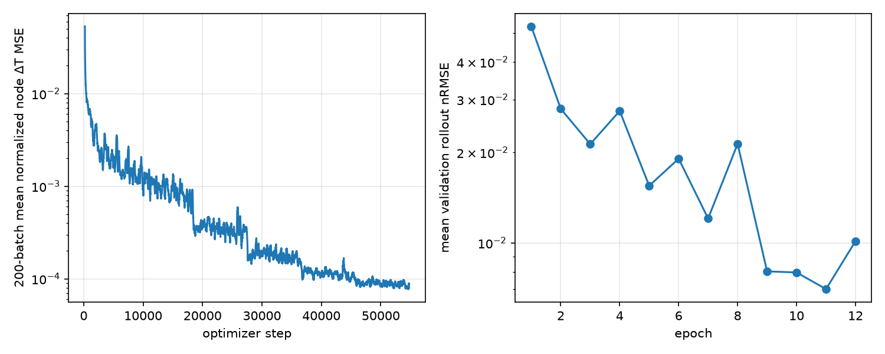
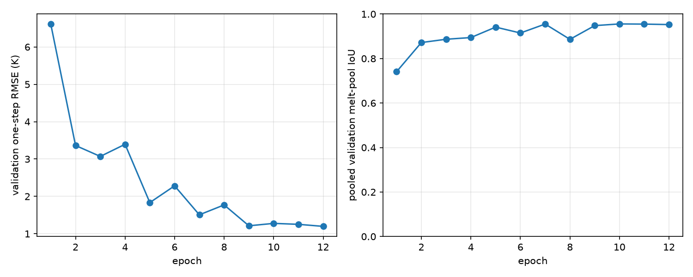
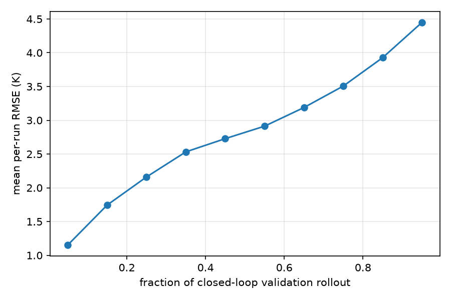

# U-Net baseline: final evaluation

## Executive summary and key findings

This baseline predicts a five-frame temperature change on a 5 µm grid, samples it at the original mesh nodes, and adds it to the current node temperatures. Epoch 11 was selected by validation rollout nRMSE before any held-out split was evaluated.

| Split (runs) | One-step RMSE (K) | Rollout nRMSE | Melt MAE (K) | Melt IoU | Energy end | Inference (ms/step) |
| --- | ---: | ---: | ---: | ---: | ---: | ---: |
| [Validation](../unet_early_stop_retry/val_epoch_11.json) (20) | 1.25 | 0.00702 | 8.09 | 0.955 | -0.27% | 13.2 |
| [test_interp](unet_test_interp_s5.json) (30) | 1.28 | 0.00740 | 8.66 | 0.953 | -0.20% | 14.8 |
| [test_extrap](unet_test_extrap_s5.json) (15) | 2.62 | 0.01426 | 14.47 | 0.943 | +1.38% | 13.6 |
| [test_path](unet_test_path_s5.json) (20) | 10.85 | 0.08160 | 79.52 | 0.744 | +3.07% | 13.8 |
| [test_fine](unet_test_fine_s5.json) (30) | 1.81 | 0.00748 | 8.96 | 0.942 | -0.23% | 13.4 |
| [test_large](unet_test_large_s5.json) (10) | 21.60 | 0.34978 | 340.35 | 0.204 | +118.16% | 51.3 |
| [test_interp, mesh seed 1](unet_test_interp_seed1_s5.json) (30) | 1.28 | 0.00738 | 8.75 | 0.952 | -0.19% | 13.9 |

In-range laser settings and a new mesh seed have similar errors. Power/speed extrapolation is worse, and unseen paths are much worse: mean nRMSE is **0.0615** on L-turns and **0.1017** on zigzags. The worst path run reaches nRMSE 0.1848 and final energy error +74.8% of input. The large plate fails across all ten runs (nRMSE 0.284–0.404; final energy error +104% to +165%); two of four no-pool runs acquire a predicted pool. The pilot's GroupNorm size sensitivity is a possible explanation, **not a demonstrated cause**. These are final observations, not tuning signals for this checkpoint.

The data and truth come from a simplified conduction-only simulator; liquid flow, evaporation and surface losses are absent. This is one trained seed and one validation-selected checkpoint. Since training stopped at the epoch cap rather than the patience rule, convergence is unresolved. Held-out scores are not an unbiased estimate for any future model revised after seeing them. No further training or hyperparameter search was performed here.

## Methodology and experimental protocol

### Architecture and mesh conversion

The 488,705-parameter GroupNorm U-Net uses a 5 µm raster, stride 5, and three inputs: current temperature, melted fraction from `run.phi(T)`, and laser energy accumulated over exactly five frames by `run.laser(k, 5)`. Its output is normalized ΔT. Grid predictions are sampled at the original mesh nodes, denormalized and added to the **original node temperatures**. During rollout, melted fraction and the next input are computed from the predicted state. The training loss is normalized node ΔT MSE after grid-to-node sampling.

### Training and checkpoint selection

The final run used seed 0, batch 4, Adam starting at `1e-3`, and `ReduceLROnPlateau` (factor 0.5, floor `1e-5`) on validation rollout nRMSE. The stopping rule was maximum 12 epochs, patience 3 and minimum relative improvement 1%. All 150 train and 20 validation runs were used, with 18,253 training examples per epoch. The older three-epoch checkpoint had no optimizer state, so this was a fresh seeded run. Recorded time for its 12 completed training/validation epochs was **119 minutes** on MPS; this excludes partial work discarded during an interruption before the resumable restart.

The run reached the **12-epoch cap**; early stopping did not fire. Epoch 11 was best (nRMSE 0.007016); epoch 12 worsened to 0.010130 while one-step RMSE improved from 1.25 to 1.20 K. The patience rule therefore did **not** establish convergence. The selected checkpoint was saved independently of the 1% patience threshold.

The selected model is `checkpoints/unet_early_stop_retry_group_s5_seed0.pt`, **epoch 11**, chosen before opening held-out splits by the lowest mean validation rollout nRMSE (**0.007016**). SHA-256: `229bed6b91c7c78ffad25be8ad0274bfdb494f81d1ebdda6d0415cf40875b392`. The existing one-step diagnostic was generalized to mixed meshes and checked against validation before the held-out run.

### Evaluation and metrics

nRMSE is the mean of per-run closed-loop scores. One-step RMSE uses the true current state at every valid start frame; it is a separate diagnostic. Melt-range MAE pools true 1,800–2,000 K node-frame pairs; IoU pools area-weighted melt-pool intersections and unions. Energy end is the median signed predicted-minus-true mesh energy at the final scored frame, divided by total laser input. Inference time is the shared evaluator's sum of `predictor.step` wall time divided by scored steps; it includes rasterization, U-Net inference and grid-to-node sampling, but excludes data loading and scoring.

Held-out evaluation used `test_interp`, `test_extrap`, `test_path`, `test_fine`, `test_large` and the planned unseen mesh test (`test_interp` on mesh seed 1), **once each**. The seed-1 test reuses the same solver runs on a differently jittered mesh. No weights, normalization statistics, split definitions or shared rollout rules were changed after checkpoint selection. All six result files record its hash; no held-out score was used to choose a model or change the protocol.

### Historical experiments and design decisions

| Historical model | Training stage | Validation rollout nRMSE | Interpretation |
| --- | --- | ---: | --- |
| [LF-T, K=5 ridge](../archive/unet_3_epoch/lf_t_val_s5.json) | Linear-filter baseline | 0.34033 | Different model, same stride and validation evaluator; LF-T code is on its own branch. |
| [GroupNorm pilot](../archive/unet_norm_pilot/group_val.json) | Six training runs, 120-step budget, selected step 60 | 0.28867 | Normalization pilot only. |
| [Pixel-wise LayerNorm pilot](../archive/unet_norm_pilot/pixelwise_layer_val.json) | Same six-run pilot, selected step 60 | 0.51565 | Normalization ablation only. |
| [Three-epoch U-Net](../archive/unet_3_epoch/full_metrics.json) | 150 runs, cosine schedule | 0.01367 | Earlier full-data checkpoint. |
| Selected U-Net | 150 runs, plateau schedule, epoch 11 | **0.00702** | 48.7% lower validation nRMSE than the three-epoch checkpoint. |

These runs differ in data budget or learning-rate schedule, so their score differences do not isolate a single causal change. The pilot's synthetic hotspot check found a large size-dependent response under GroupNorm; it did not measure accuracy on a real large plate. Historical machine-readable results and unique plots are in [`results/archive`](../archive/).

## Detailed results and reproducibility

### Resolution and energy diagnostics

The paired 10 µm versus 5 µm **solver** comparison on `test_fine` gives nRMSE **0.00507**, melt-range MAE **4.61 K** and IoU **0.976** ([cross-solver JSON](cross_test_fine_s5.json), [CSV](cross_test_fine_s5.csv)). It measures a resolution gap, not a model error floor that can be subtracted from the U-Net score.

The shared evaluator also reports three energy errors. Each cell below is **median / largest absolute run**, in percent of laser input. `a` is maximum absolute error relative to input received so far after 5% has arrived; `b` is maximum absolute error relative to total input; `end` is signed final error for the median and absolute final error for the maximum. Per-run CSVs are available for [interp](unet_test_interp_s5.csv), [extrap](unet_test_extrap_s5.csv), [path](unet_test_path_s5.csv), [fine](unet_test_fine_s5.csv), [large](unet_test_large_s5.csv) and [mesh seed 1](unet_test_interp_seed1_s5.csv); the CSVs and JSON summaries retain soft IoU, solidification and energy budget.

| Split | Energy a (%) | Energy b (%) | Energy end (%) |
| --- | ---: | ---: | ---: |
| test_interp | 1.03 / 13.56 | 0.70 / 3.73 | -0.20 / 3.73 |
| test_extrap | 1.72 / 3.82 | 1.59 / 3.82 | +1.38 / 3.82 |
| test_path | 4.32 / 74.82 | 3.79 / 74.82 | +3.07 / 74.82 |
| test_fine | 1.03 / 13.47 | 0.71 / 3.70 | -0.23 / 3.70 |
| test_large | 118.16 / 179.18 | 118.16 / 165.09 | +118.16 / 165.09 |
| test_interp, seed 1 | 1.06 / 13.55 | 0.70 / 3.74 | -0.19 / 3.74 |

### Complete selected-run history

The [complete epoch history](../unet_early_stop_retry/history.json), [batch losses](../unet_early_stop_retry/batches.csv), [per-epoch validation CSV/JSON](../unet_early_stop_retry/val_epoch_11.csv), [rollout progression](../unet_early_stop_retry/temporal_best.csv) and [resumable optimizer state](../unet_early_stop_retry/training_state.pt) are preserved at their original paths.







### Checkpoint index

Every filename below is relative to the versioned `checkpoints/` directory; paths are unchanged. All use a 5 µm grid, stride 5 and seed 0; only the selected checkpoint produced the held-out table. The pilot checkpoints use six training runs, while the other three use all 150.

| Checkpoint | Configuration and stage | Validation nRMSE | Role |
| --- | --- | ---: | --- |
| `unet_norm_pilot_group_s5_seed0.pt` | GroupNorm, pilot step 60 | 0.288670 | Historical pilot |
| `unet_norm_pilot_pixelwise_layer_s5_seed0.pt` | Pixel-wise LayerNorm, pilot step 60 | 0.515652 | Historical ablation |
| `unet_full_group_s5_seed0.pt` | GroupNorm, 3-epoch full-data run | 0.013669 | Historical full-data model |
| `unet_early_stop_group_s5_seed0.pt` | GroupNorm, interrupted run, best epoch 7 | 0.012054 | Historical intermediate checkpoint |
| `unet_early_stop_retry_group_s5_seed0.pt` | GroupNorm, 12-epoch run, best epoch 11 | **0.007016** | **Selected final model** |

### Reproduction commands

From the repository root, install `requirements.txt`, generate or obtain the solver runs, prepare processed data and training statistics, then use a **new** output path when reproducing the training run. See the README for data generation. These commands assume an MPS device; replace it with `cpu` or `cuda` where appropriate.

```bash
python3 -m graphs.preprocess
python3 -m graphs.preprocess --splits test_interp --mesh-seed 1
python3 -m graphs.dataset --stride 5
python3 -m evaluation.rollout --size-bins
python3 -m models.train_unet_early_stop --max-epochs 12 --patience 3 --min-relative-improvement 0.01 --seed 0 --batch-size 4 --lr 0.001 --min-lr 0.00001 --device mps --checkpoint checkpoints/unet_reproduction_group_s5_seed0.pt --out-dir results/unet_reproduction
python3 -m models.plot_unet_history --out-dir results/unet_reproduction --device mps
```

If a reproduced run is interrupted after a completed epoch, rerun its training command with `--resume`. Evaluate the **frozen selected checkpoint** with the same shared evaluator; write reproductions to a new directory to preserve these results:

```bash
for split in test_interp test_extrap test_path test_fine test_large; do
  python3 -m models.evaluate_unet --checkpoint checkpoints/unet_early_stop_retry_group_s5_seed0.pt --split "$split" --device mps --out results/unet_reproduction_eval
done
python3 -m models.evaluate_unet --checkpoint checkpoints/unet_early_stop_retry_group_s5_seed0.pt --split test_interp --mesh-seed 1 --device mps --out results/unet_reproduction_eval
python3 -m evaluation.rollout --split test_fine --stride 5 --predictor cross --out results/unet_reproduction_eval
```

### Artifact scope and cleanup

This is the single authoritative U-Net report. The selected run's complete history, plots and `training_state.pt` remain in `results/unet_early_stop_retry/`; unique pilot and three-epoch results remain in `results/archive/`; final machine-readable results remain beside this report. The five indexed checkpoints and the 5.7 MB optimizer state are unignored so they can be versioned with the history. Raw runs, processed graphs, logs and future experimental checkpoints are Git-ignored and local-only.

Earlier pilot, three-epoch and early-stop reports, two overlapping report-generation scripts, and duplicate or transient outputs were removed. The first interrupted run's seven epoch metrics matched the completed run; its epoch-7 **checkpoint remains**. `data/splits.json` and LF-T were left untouched.
